# Shipment Booking System

A small courier booking system built with a **Laravel 13 REST API** and an **Angular 21** front end.

Customers book parcels with a live price. A queued job books each parcel with a courier in the background, and every status change is tracked in a history timeline. Admins move shipments through their statuses.

<p align="center">
  
</p>

---

## What's inside

| Folder | Stack | Highlights | Docs |
|--------|-------|------------|------|
| [`backend/`](backend) | Laravel 13, Sanctum, MySQL | Policies, global/group/route middleware, Form Request validation, a service provider with interface binding, queued jobs with retries, observer, events and listeners | [README](backend/README.md) · [Interview guide](backend/docs/INTERVIEW_GUIDE.md) |
| [`frontend/`](frontend) | Angular 21, TypeScript, RxJS | Standalone components, signals, functional guards and interceptors, lazy loading, reactive forms, live price with `switchMap`, `@defer` | [README](frontend/README.md) · [Angular guide](frontend/docs/ANGULAR_GUIDE.md) |

## How it works

```
Angular (localhost:4200)  --Bearer token-->  Laravel API (localhost:8000)  -->  MySQL
                                                   |
                                                   +--> queue job: book with courier
                                                   +--> event: save history + send email
```

1. A customer creates a shipment. Laravel validates it, calculates the price on the server and saves it as **pending**.
2. A **queued job** books it with the courier, with retries and backoff.
3. A **model observer** fires an event on every status change. One listener saves the history right away, and a queued listener sends an email.
4. The Angular detail page **refreshes by itself** while the shipment is pending, so you can watch it change to **booked**.

## Quick start

**Requirements:** PHP 8.3+, Composer, MySQL 8, Node 20.19+ or 22.12+.

```bash
# 1. Backend
cd backend
composer install
cp .env.example .env
php artisan key:generate
# create a MySQL database called shipment_api, then check DB_* in .env
php artisan migrate --seed

php artisan serve                                              # terminal 1 -> http://localhost:8000
php artisan queue:work --queue=courier,notifications,default   # terminal 2

# 2. Frontend
cd ../frontend
npm ci
npm start                                                      # terminal 3 -> http://localhost:4200
```

**Demo logins** (password `password`):

| Role | Email |
|------|-------|
| Customer | customer@example.com |
| Admin | admin@example.com |

## Screenshots

<table>
  <tr>
    <td width="50%" valign="top">
      <b>Login</b><br>One-click demo accounts<br><br>
      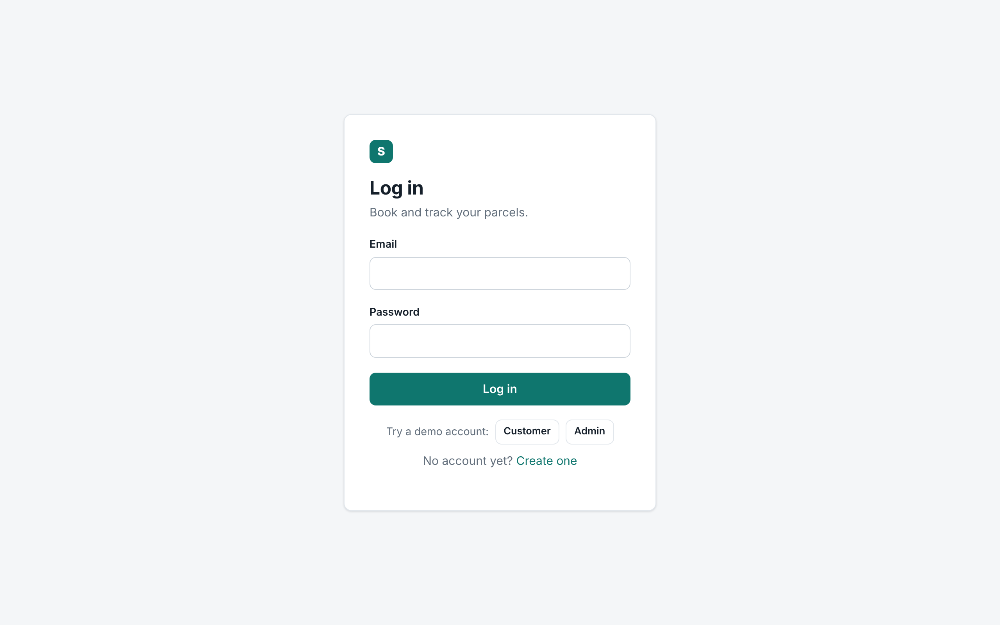
    </td>
    <td width="50%" valign="top">
      <b>Server validation</b><br>Laravel's 422 message shown under the field<br><br>
      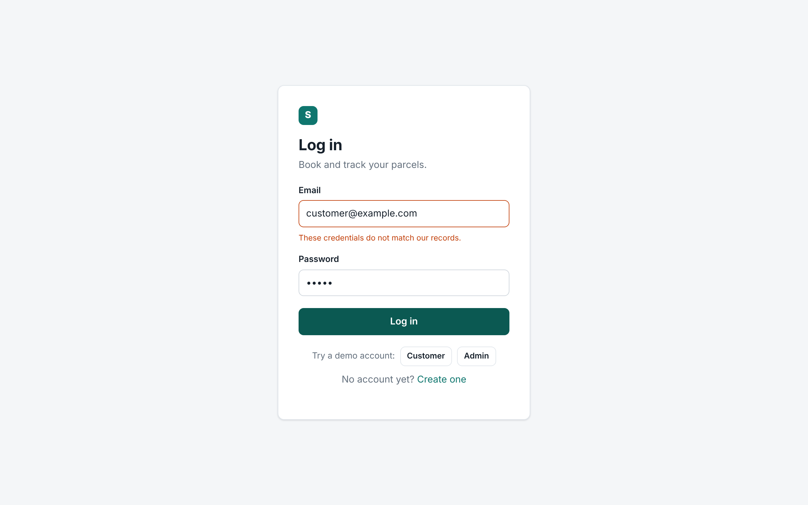
    </td>
  </tr>
  <tr>
    <td valign="top">
      <b>Register</b><br>Client-side validation and password match<br><br>
      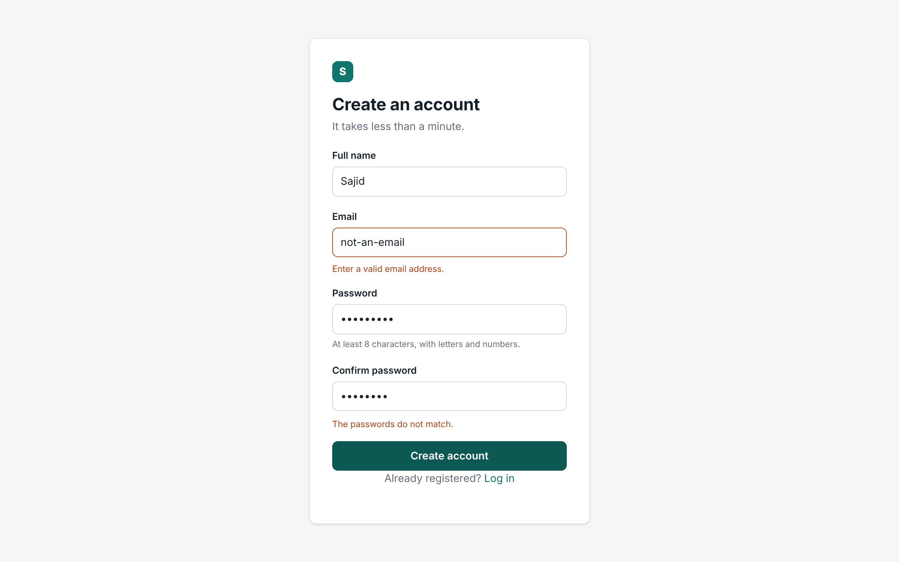
    </td>
    <td valign="top">
      <b>Dashboard</b><br>Count per status; click a card to filter the list<br><br>
      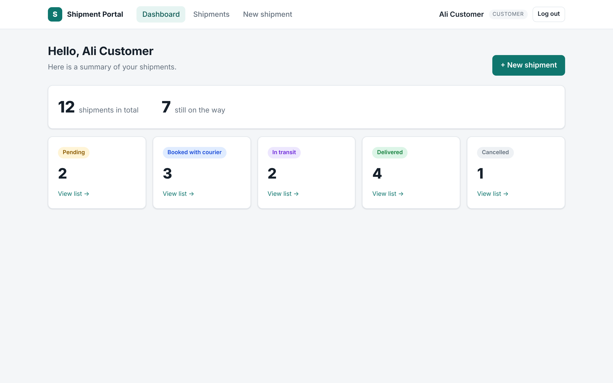
    </td>
  </tr>
  <tr>
    <td valign="top">
      <b>Shipments list</b><br>Paginated results from the API<br><br>
      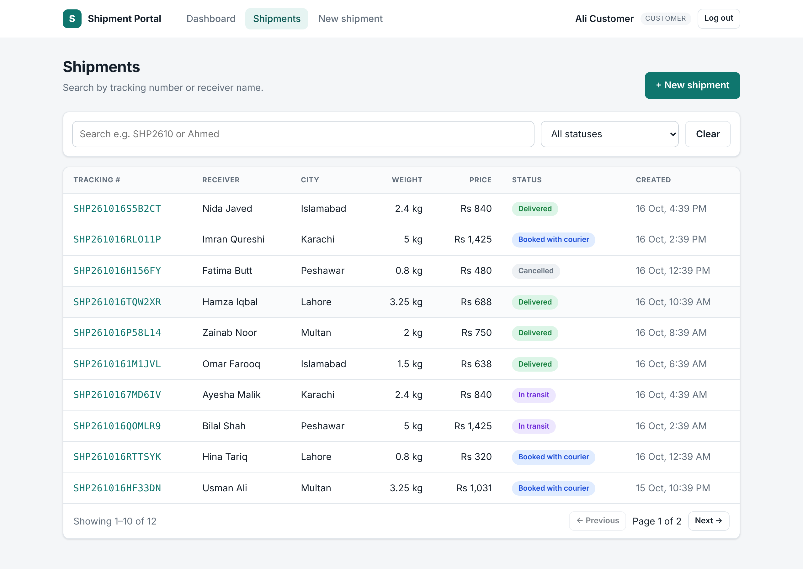
    </td>
    <td valign="top">
      <b>Search and filter</b><br>Debounced search; <code>switchMap</code> cancels old requests<br><br>
      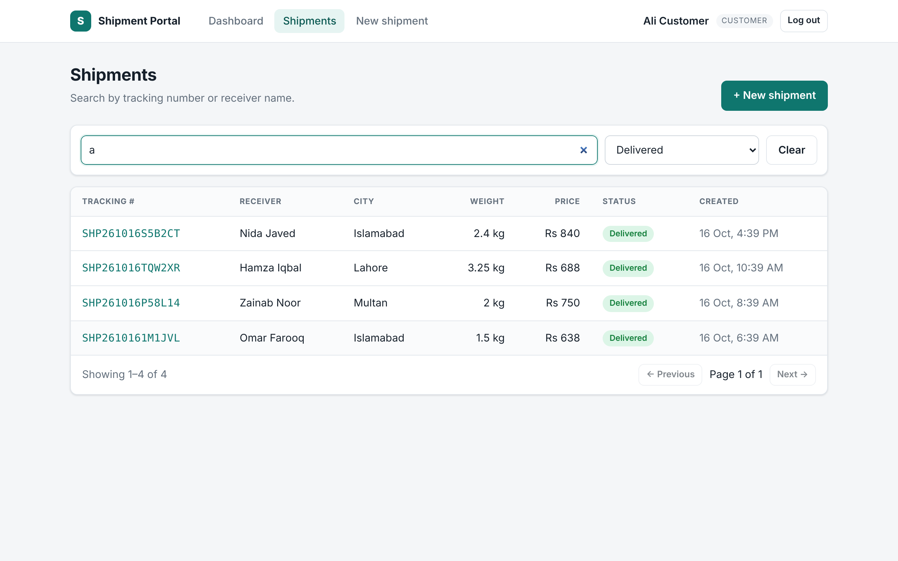
    </td>
  </tr>
  <tr>
    <td valign="top">
      <b>New shipment</b><br>Live price from the API, plus validation<br><br>
      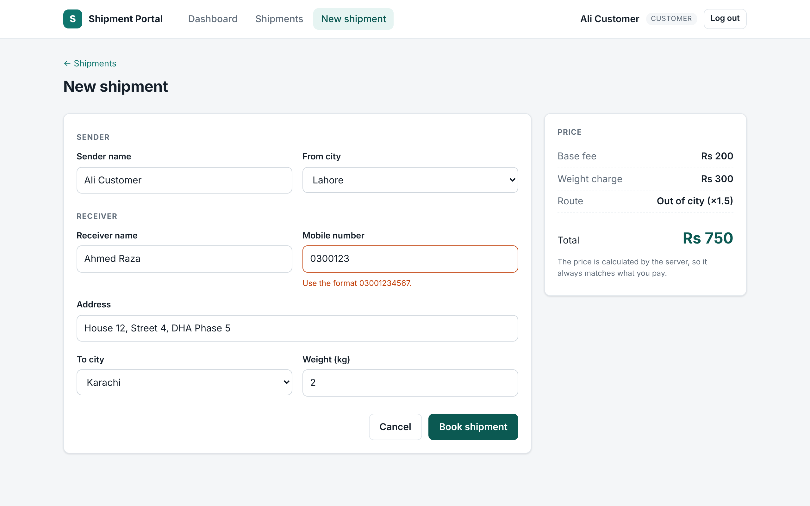
    </td>
    <td valign="top">
      <b>Pending</b><br>The Laravel queue job is booking it in the background<br><br>
      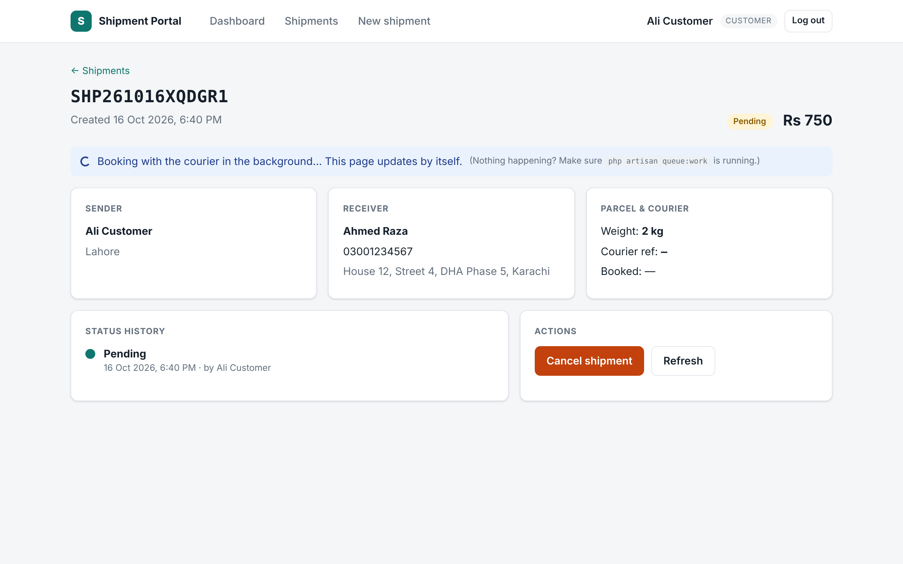
    </td>
  </tr>
  <tr>
    <td valign="top">
      <b>Booked</b><br>The page updated by itself when the job finished<br><br>
      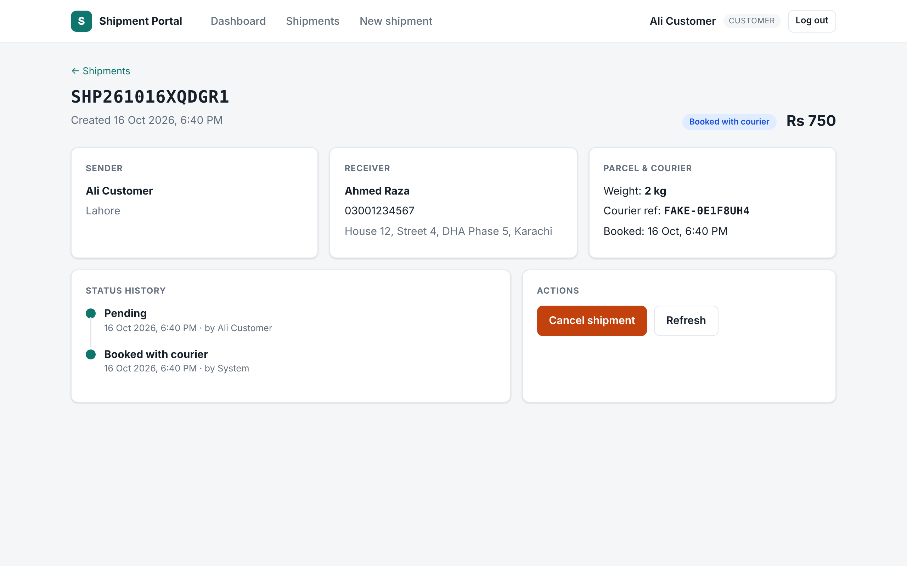
    </td>
    <td valign="top">
      <b>Admin dashboard</b><br>Admins see every shipment<br><br>
      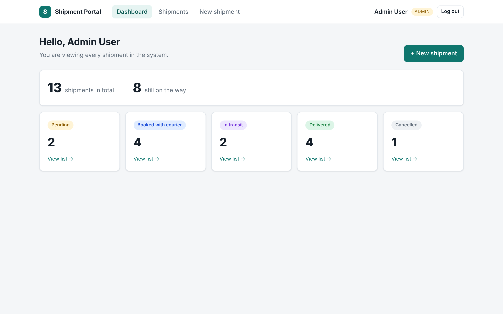
    </td>
  </tr>
  <tr>
    <td valign="top">
      <b>Admin status change</b><br>Child component with input and output<br><br>
      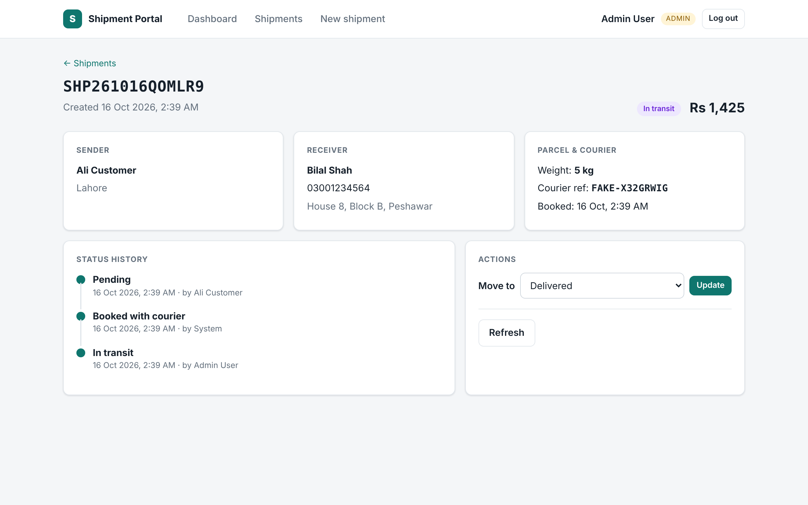
    </td>
    <td valign="top">
      <b>Status updated</b><br>History timeline and a success toast<br><br>
      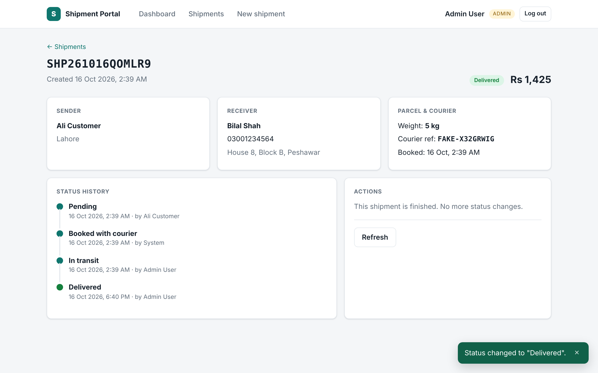
    </td>
  </tr>
  <tr>
    <td valign="top">
      <b>Mobile</b><br>Responsive layout<br><br>
      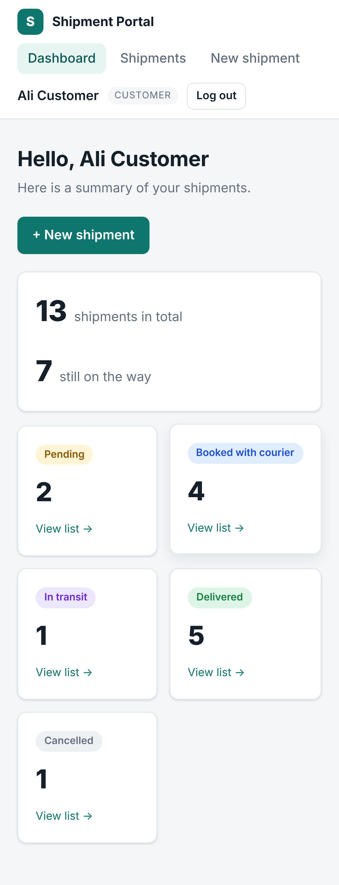
    </td>
    <td></td>
  </tr>
</table>

## API overview

| Method | Endpoint | Who |
|--------|----------|-----|
| POST | `/api/auth/register`, `/api/auth/login` | guest |
| GET / POST | `/api/auth/me`, `/api/auth/logout` | logged in |
| GET | `/api/dashboard` | logged in |
| POST | `/api/shipments/quote` | logged in |
| GET / POST | `/api/shipments` | logged in |
| GET | `/api/shipments/{id}` | owner or admin |
| POST | `/api/shipments/{id}/cancel` | owner or admin |
| PATCH | `/api/admin/shipments/{id}/status` | admin |

You'll find the full request and response examples in the [backend README](backend/README.md).

## Tests

```bash
cd backend  && php artisan test   # feature + unit tests (SQLite in memory)
cd frontend && npm test           # Vitest: pipe, validators, auth interceptor
```

## Project structure

```
.
├── README.md
├── docs/
│   └── screenshots/        <- the 13 PNG files used above
├── backend/                <- Laravel 13 API
└── frontend/               <- Angular 21 app
```
