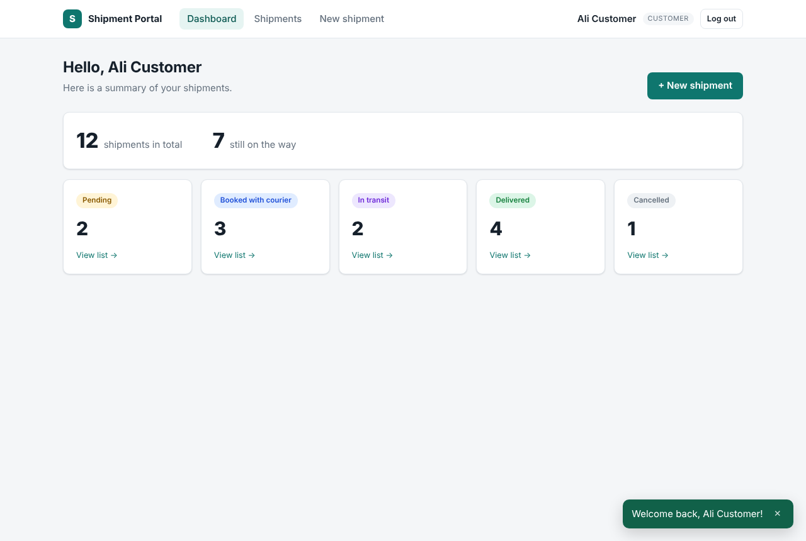

# Shipment Portal — Angular 21 front end

The Angular app for the **Shipment API** (Laravel 13 + Sanctum). Customers log in, see a dashboard, search their shipments, book a new one with a live price, and watch it get booked by the Laravel queue worker. Admins can move a shipment through its statuses.

> Want the explanation and interview story? Read **[docs/ANGULAR_GUIDE.md](docs/ANGULAR_GUIDE.md)**.



---

## 1. What you need

| Tool | Version |
|------|---------|
| Node.js | **20.19+** or **22.12+** (check with `node -v`) |
| npm | 10+ |
| The Laravel API | the `shipment-api` project, running on `http://localhost:8000` |

You don't need to install the Angular CLI globally. `npx ng` and `npm start` use the version in the project.

## 2. Setup (first time)

```bash
cd shipment-portal
npm install
```

The project includes an `.npmrc` with `legacy-peer-deps=true`. This avoids a known peer-dependency bug in some npm 10 versions, so a plain `npm install` works.

## 3. Run everything (3 terminals)

```bash
# Terminal 1 — Laravel API (in the shipment-api folder)
php artisan serve                                        # http://localhost:8000

# Terminal 2 — Laravel queue worker (in the shipment-api folder)
php artisan queue:work --queue=courier,notifications,default

# Terminal 3 — Angular (in the shipment-portal folder)
npm start                                                # http://localhost:4200
```

Open **http://localhost:4200** and use a demo account. The login page has one-click buttons for both.

| Role | Email | Password |
|------|-------|----------|
| Customer | customer@example.com | password |
| Admin | admin@example.com | password |

> The Laravel database must be seeded first (`php artisan migrate --seed`), otherwise the demo users don't exist.

## 4. Configuration

The API address is set in the environment files:

| File | Used by | `apiUrl` |
|------|---------|----------|
| `src/environments/environment.development.ts` | `npm start` / `ng serve` | `http://localhost:8000/api` |
| `src/environments/environment.ts` | `npm run build` (production) | `/api` (same domain as the app) |

`angular.json` swaps them automatically (`fileReplacements`).

On the Laravel side, `FRONTEND_URL=http://localhost:4200` in `.env` lets the browser call the API (CORS). If you run Angular on another port, change it there too.

## 5. Other commands

```bash
npm test          # unit tests (Vitest): 3 files, 8 tests
npm run build     # production build -> dist/shipment-portal/browser
```

To deploy, copy `dist/shipment-portal/browser` to a web server, and send every unknown URL to `index.html` so Angular's router can handle it.

## 6. Pages

| URL | Page | Who |
|-----|------|-----|
| `/login`, `/register` | Log in / create account | guests only (`guestGuard`) |
| `/dashboard` | Totals and a card per status. Click a card to open the filtered list. | logged in (`authGuard`) |
| `/shipments` | Search, status filter and pagination | logged in |
| `/shipments/new` | Booking form with a live price from the server | logged in |
| `/shipments/:id` | Details, status history, Cancel button, admin status changer. Refreshes by itself while the status is "pending". | owner or admin |

## 7. Project structure

```
src/
  environments/                     API URL for dev and production
  app/
    app.config.ts                   router, HttpClient + interceptors, app initializer
    app.routes.ts                   routes, guards, lazy loading
    app.ts                          root: <router-outlet> + toasts
    core/                           singletons used everywhere
      auth/        auth.service.ts      who is logged in (signals), login/register/logout
                   auth.guard.ts        authGuard, guestGuard
                   token-storage.service.ts
      interceptors/ auth.interceptor.ts  adds "Authorization: Bearer <token>"
                   error.interceptor.ts 401 / 403 / 429 / 500 handled in one place
      models/                       TypeScript types that match the Laravel JSON
      services/    shipment.service.ts  every API call
                   toast.service.ts     notifications
    layout/        shell.component      header + nav around logged-in pages
    features/      auth/  dashboard/  shipments/   (one folder per feature, lazy loaded)
    shared/        components/  forms/  pipes/     (reusable pieces)
```

## 8. Troubleshooting

| You see | Fix |
|---------|-----|
| Toast: "Cannot reach the server" | Laravel isn't running on port 8000 (`php artisan serve`). |
| Browser console: **CORS** error | Check `FRONTEND_URL` in Laravel's `.env`, then run `php artisan config:clear`. |
| A new shipment stays "pending" forever | The queue worker isn't running. Start `php artisan queue:work --queue=courier,notifications,default`. |
| Login says the credentials are wrong | Run `php artisan migrate --seed` in the Laravel project. |
| You're logged out after a page refresh | The token was deleted or expired. Log in again. |
